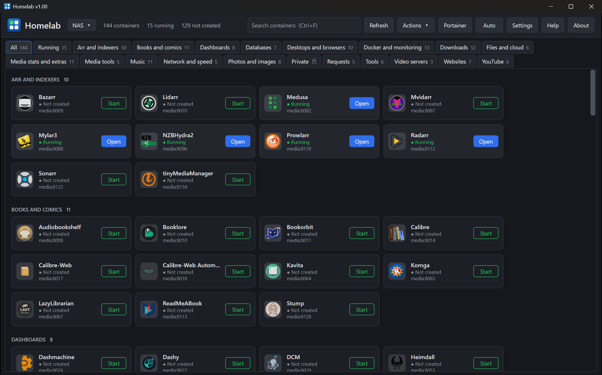

<p align="center">
  
</p>

# Homelab

Every container in your compose file as a tile, grouped by label, one click from its web page.

    

## ✨ Features

Homelab is a PowerShell/WPF tool that shows every container in your Docker Compose file as a tile, so you can get to any of them in one click.

- **Every container at once**: one tile per service, with its icon, name, running or stopped, and where Open will take you. The state refreshes every 15 seconds.
- **Open or Start**: a running container's button says **Open**. One that isn't running (stopped, exited or not created) shows a green-outlined **Start** button instead, which starts just that container. Double-clicking a tile opens it but never starts it. A web page only opens while its container is running.
- **A tab for each group**: services are grouped by their `home.group` label, with an **All** tab that lists every group under its own heading. Each tab shows how many containers it holds.
- **Running tab**: every running container as a list (icon, name, group, status, address and Open), kept up to date on every status check and filtered by the search box.
- **Open does the right thing for each container**:
  - a web app opens its page in your browser (`http://localhost:<port>`, or https for ports such as 443 and 8443, and `/web` for Plex),
  - a database opens its admin page when you have one (MariaDB and MySQL open phpMyAdmin or Adminer, Postgres opens pgAdmin or Adminer),
  - databases with no admin page (Mongo, Redis, Elasticsearch...) open a command window inside the container,
  - anything else opens its live log.
- **Right-click a tile** (or a Running row) for everything else: **Start**, **Stop** and **Restart** that one container, then web page, admin page, command window, log, config folder and copy address. Only the actions that fit its state are enabled: the web page items are greyed out until the container is running.
- **Search** across names, groups, images and descriptions. Ctrl+F to search, Enter opens the first running match on the open tab, Esc clears it.
- **Keeps up with the compose file**: save it and the tiles update by themselves, with a box showing while it's read. F5 reloads it.
- **Your own icons first**: from Homelab's **Icons** folder (beside `Builds\` and `Source\`), matched to each service by name, the same for every machine. Anything missing there is looked for in Homepage's icon folder (`homepage\icons` next to the compose file, can be turned off), then comes from [Dashboard Icons](https://github.com/homarr-labs/dashboard-icons), cached on your PC (it also reuses any icons Docker Container Manager has already downloaded). Containers with no icon anywhere get coloured initials. See [Icons](#icons).
- **Actions menu**: **Start all** or **Stop all** on the open tab, and **Restart unhealthy**, each after a confirmation that lists the containers. They run one at a time; a locked Private tab is never touched.
- **Notifications**: a Windows notification when a container becomes unhealthy or stops with an error on its own (not on the first check, and not for ones you stopped yourself). Can be turned off.
- **Update badges**: every 6 hours (or from **Actions > Check for image updates now**) Homelab asks each image's registry (Docker Hub, ghcr.io, lscr.io and others) whether its tag has moved on, and marks those tiles with a small blue arrow. A **↑ 2 updates** button then appears in the header (hover over it for their names); click it to show only those containers, and again to show everything. It never pulls or recreates anything. Works for the NAS too.
- **Keyboard**: Tab moves between buttons, tiles and Running rows (with an accent outline), Enter opens the focused tile, and the menu key shows its right-click menu.
- **Portainer button** in the header when Portainer is running on the chosen machine (this PC or the NAS; it finds the port itself), or always if you set `PortainerUrl`.
- **Light and dark themes**: the header button switches between Auto (follows Windows, and changes when Windows does), Light and Dark. The title bar, menus and Settings window match too.
- **Other machines over SSH**: switch from This PC to your NAS with the button next to the title (its menu shows each machine's address). Homelab reads that machine's compose file and container states over SSH, starts and stops its containers there, opens web pages at its address, and opens command windows and logs there.
- **Settings window**: add and edit machines (address, SSH user and port, folders, web address, path map) with a **Test connection** button, pick this PC's compose file, and set the refresh time, Portainer address, Private groups, notifications, the update check, the Icons folder and the Homepage fallback. **Save** applies the changes and keeps the window open (showing *Saved.*); **Close** shuts it. The theme is set only with the header button.
- **Private tab lock**: groups you name (default `Private`) are hidden from All, Running, search and the counts until you type a password. It hides them in Homelab; it isn't encryption.
- **Help** button (or F1): how everything works, in its own window.
- **Never touches the compose file**: containers are only started, stopped or restarted when you ask, one at a time.
- **Stays responsive**: Docker and SSH run in the background with time limits (90 seconds for reads, 15 minutes for a start or restart, which may pull an image first), icons download one at a time without holding anything up, and an unexpected error shows in the yellow banner (with a ✕ to dismiss it) instead of closing the window.
- **One window**: starting Homelab again brings the open one to the front. Its size and position are remembered and kept on screen.

## 🖼️ Screenshots



## 📋 Requirements

- Windows 10 or 11.
- Windows PowerShell 5.1 (built into Windows) with .NET Framework 4.7.2 or later.
- [Docker Desktop](https://www.docker.com/products/docker-desktop/) (or another engine `docker.exe` can reach) with Compose v2.
- A `docker-compose.yml`. Homelab uses `E:\Docker\docker-compose.yml` until you pick another one.

## 📦 Installation

1. Download `Homelab-v1.03.zip` from the [latest release](../../releases/latest).
2. Right-click the zip, choose **Properties**, tick **Unblock** and click OK, *before* extracting it. (Or, after extracting, run `Get-ChildItem -Recurse 'Homelab v1.03' | Unblock-File` in PowerShell.) Files from the internet carry Windows' Mark of the Web, which makes Windows warn about or block scripts.
3. Extract it anywhere. You get a `Homelab v1.03` folder.
4. Double-click **Homelab.cmd** in that folder. It makes a **Homelab** shortcut in the folder and in the Start menu, then starts Homelab.

From then on, start Homelab from the shortcut or the Start menu, and pin it to the taskbar if you like: it starts without a console window and shows Homelab's own icon. For a new version, extract it and run its Homelab.cmd once; the Start menu shortcut then points at the new folder. Settings are kept in `%APPDATA%\Homelab`, so they carry over.

For the Home Launcher, put the release in `Home\Homelab\Builds\` (Build.cmd does this) and it starts Homelab through `Builds\Homelab.lnk`, under Windows.

**From the repo:** clone it, then double-click **Start Homelab.cmd** (add `debug` to keep a console open and see any errors), or run `src\New-HomelabShortcut.ps1` to make a shortcut for the repo copy.

### Why no exe?

Up to v1.02 Homelab shipped as an exe made with [PS2EXE](https://github.com/MScholtes/PS2EXE). Antivirus programs (ESET among them) kept flagging those exes as trojans by mistake, because PS2EXE wraps a script the way some malware does. Homelab is a script anyway, so it now ships as the script itself: nothing is compiled or packed, and you can read exactly what runs.

The shortcut runs `conhost.exe --headless powershell.exe -NoProfile -ExecutionPolicy Bypass -STA -File "...\Homelab.ps1"`. `--headless` stops Windows 11 opening a console window; on older Windows the shortcut runs PowerShell with `-WindowStyle Hidden` instead, so a console may flash for a moment. The execution-policy bypass applies to Homelab's own run only; no Windows settings are changed. The shortcut and the script share a taskbar ID (`jason4bury.Homelab`), so the taskbar groups Homelab under its own icon rather than PowerShell's. A shortcut can only hold a full path, which is why Homelab.cmd makes it on your PC instead of it coming in the zip.

### Build a release

Double-click **Build.cmd** in the repo folder. It reads `build.json`, checks every script in `src\` parses and that `$script:AppVersion` matches the newest `CHANGELOG.md` entry, and runs PSScriptAnalyzer if it's installed. Then it makes `..\Builds\Homelab v<version>\` and `..\Builds\Homelab-v<version>.zip` (outside the repo), refreshes `..\Builds\Homelab.lnk` for the Home Launcher, and scans the lot with ESET's command-line scanner (`ecls.exe`) if it's installed. Everything it shows is also in `Build.log`. Older release folders stay alongside.

## 🚀 Usage

1. Start Homelab (the Homelab shortcut, the Start menu, or **Homelab.cmd**).
2. Pick a tab, or stay on **All**.
3. Click **Open** on a tile, or double-click the tile. If it isn't running, click **Start**.
4. Right-click a tile for its other ways in, and to stop or restart it.
5. The **Running** tab lists what's running right now; the **Help** button (or F1) explains the rest.

To use a different compose file, click the file name in the status bar at the bottom, or use **Settings > This PC**. To see your NAS, pick it on the machine button next to the title.

The first time you open a **Private** tab it asks you to choose a password (typed twice). After that it asks for it once per session. **Cancel** (or Esc) takes you back to the tab you were on without setting or checking a password, and the tab stays locked. **Lock** on the tab hides it again. Change or remove the password in **Settings > General** (the current password is needed).

## ⚙️ Configuration

### Labels

Homelab reads these labels from each service in the compose file. All of them are optional.

| Label | What it does |
|---|---|
| `home.group` | The tab the tile goes on. Services without one go on **Other**. |
| `home.name` | The name on the tile, instead of one made from the service name. |
| `home.description` | Shown when you hover over the tile, and searched. |
| `home.icon` | The icon to use when it isn't named after the service: a file name from the Icons folder (`pvault.png`), a full path, or a [Dashboard Icons](https://github.com/homarr-labs/dashboard-icons) name. |
| `home.url` | The web address to open, instead of the first published port. It also skips the database rule (a database with `home.url` opens that address, not its admin page). `none` means it has no web page. |
| `home.open` | What Open does: `shell` (command window), `log`, `none`, the name of another service (opens that one, such as an admin page), or a full URL. |
| `home.hide` | `true` leaves the service out of Homelab. |

```yaml
  mariadb:
    image: lscr.io/linuxserver/mariadb
    labels:
      home.group: "Databases"
      home.open: "phpmyadmin"
```

### Env files

Homelab reads the compose file with `docker compose config`. If the compose folder has a `.env`, Docker uses it. If not, Homelab uses `Env_Windows` from the same folder (or from `env\`), so `${...}` paths in volumes still read correctly.

### Other machines

Homelab can show the containers on another machine, such as a Synology NAS, instead of this PC. It uses Windows' own `ssh.exe` (the OpenSSH Client) with a key, so the machine needs SSH turned on and your key in its `authorized_keys`.

The first time it starts, Homelab copies the machine list from Docker Container Manager. To add or change one, use **Settings > Machines** (with **Test connection** to check SSH and Docker). They're kept as `Machines` in `settings.json`:

```json
"Machines": [
  {
    "Name": "NAS",
    "Login": "user@192.168.0.10",
    "Port": "22",
    "Folder": "/volume1/homes/user",
    "ComposeFile": "docker-compose.yml",
    "Project": "media",
    "WebHost": "nas",
    "PathMap": { "/volume1/homes/user": "\\\\nas\\home", "/volume1/docker": "\\\\nas\\docker" }
  }
]
```

| Setting | What it's for |
|---|---|
| `Login`, `Port` | How to reach the machine with `ssh`. |
| `Folder`, `ComposeFile` | Where its compose file and `.env` are. |
| `Project` | The compose project name its containers were started under, if it isn't the folder's name. |
| `WebHost` | The host name web pages open at, such as `nas` or `media`. Blank means the address in `Login`. |
| `PathMap` | Turns its folders into share paths, so **Config folder** opens them in Explorer. |

> [!IMPORTANT]
> Use a host name for the web address, not an IP address. Some apps, such as Radarr and Prowlarr, only answer to names on their allowed-hosts list and show *HTTP Error 400. The request hostname is invalid* when opened by IP. `Login` can still use the IP for SSH, but then `WebHost` must be filled in with a name. **Settings** won't save an IP address there, and shows a warning under **Web address** as soon as you type one.

Homelab never changes the machine's compose file. Start, Stop and Restart run `docker compose up -d --no-deps`, `stop` and `restart` for one service there. Changes to its compose file show after **Refresh** (F5), not straight away.

### Private groups

`PrivateGroups` in `settings.json` (or **Settings > General**) lists the groups kept behind the lock, `["Private"]` by default. Only a salted PBKDF2 hash of the password is stored (`PrivatePasswordHash` and `PrivatePasswordSalt`, SHA-256, 100,000 rounds). The lock hides those containers in Homelab only; they're still in Docker and the compose file.

### Icons

Put your own icons in Homelab's **Icons** folder. By default that's the `Icons` folder beside `Builds\` and `Source\` (for example `E:\Created\Home\Homelab\Icons`, shared by every release folder in `Builds\`). A release extracted anywhere else uses an `Icons` folder inside its own folder, so point the setting at a fixed folder if you keep more than one version. Homelab makes it if it isn't there, and **Settings > General > Icons folder** can point somewhere else. The same folder is used for every machine, so the NAS needs no icon folder of its own.

Name each file after the service or container, for example `jellyfin.png` or `calibre-web-automated.png`. Case, spaces, `-` and `_` don't matter (so `Calibre Web Automated.png` matches too), and the image name works as well. PNG, JPG, GIF, BMP and ICO all work.

> [!NOTE]
> Icons aren't included in this repo: the logos belong to their own projects. The `Icons` folder sits outside `Source\` so it never goes to GitHub (and `.gitignore` lists `Icons/` as a safety net). Anything you don't have, Homelab downloads from [Dashboard Icons](https://github.com/homarr-labs/dashboard-icons).

Homelab looks for each service's icon in this order:

1. The `home.icon` label: a full path to an image, or a name looked up in the places below.
2. The **Icons** folder.
3. Homepage's icon folder, if **Fall back to Homepage icons** is ticked (it is by default): `HomepageIconFolder`, or `homepage\icons` in the compose file's folder (so `E:\Docker\homepage\icons`).
4. The download cache: Homelab's (`%LOCALAPPDATA%\Homelab\Icons`), then Docker Container Manager's (`%LOCALAPPDATA%\Docker Container Manager\Icons`).
5. A download from [Dashboard Icons](https://github.com/homarr-labs/dashboard-icons) (in the background, one at a time) into Homelab's cache. A name it doesn't have isn't asked for again for two weeks.
6. Coloured initials.

### Notifications and image updates

When a container becomes unhealthy, or stops with an error, between two status checks, Windows shows a notification from Homelab's notification-area icon (click it to come back). It's skipped on the first check after starting or switching machine, for containers you started, stopped or restarted in the last 3 minutes, and for hidden Private ones. `NotifyProblems` (Settings > General) turns it off.

Every 6 hours, starting 2 minutes after the first read, Homelab lists the pulled images on the chosen machine (`docker image ls --digests`, over SSH for the NAS) and asks each image's registry for the digest of the same tag. A tile whose image has a newer digest gets a small blue arrow on its icon, and the header says how many. It only sends read-only `HEAD` requests (with an anonymous token where the registry wants one): Docker Hub, ghcr.io, lscr.io, quay.io and other public registries work; private ones that need a login are skipped. It never pulls, recreates or restarts anything. **Actions > Check for image updates now** checks straight away; `CheckUpdates` (Settings > General) turns the timed check off.

### Where settings live

Everything Homelab stores is in `%APPDATA%\Homelab\settings.json`: the compose file, the last tab, the theme (`Theme`: System, Light or Dark), the machine (`Machine`, blank for this PC) and the `Machines` list, the window size and position, the refresh time (`RefreshSeconds`, 5 to 3600, 15 by default), the Icons folder (`IconsFolder`, blank for the one beside `Builds\`), the Homepage fallback (`UseHomepageIcons`, and `HomepageIconFolder` if it isn't `homepage\icons` next to the compose file; an old `IconFolder` setting is moved here), `NotifyProblems`, `CheckUpdates`, `PortainerUrl`, if you want the Portainer button to open somewhere else, and the Private lock (`PrivateGroups` and the password hash). Most of these can be set in the **Settings** window. Each save writes a new file and keeps the previous one as `settings.json.bak`. If `settings.json` can't be read, Homelab renames it `settings.bad-<date>-<time>.json`, starts with default settings, says so in the banner, and doesn't save over anything when it closes, so you can put the old file (or the `.bak`) back. Icons are cached in `%LOCALAPPDATA%\Homelab\Icons`. Neither is inside the repo or the `Builds\` folder, so rebuilding or updating can't touch them.

## 📝 Changelog

See [CHANGELOG.md](CHANGELOG.md).

## 📄 Licence

[MIT](LICENSE). Copyright (c) 2026 Jason Rhodes.

Created by Jason Rhodes, built with Claude (Anthropic).
